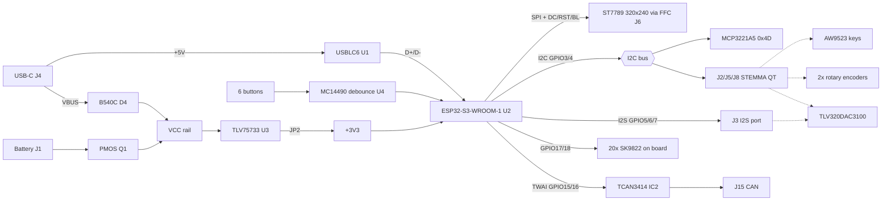
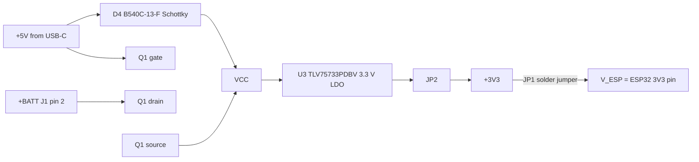

# DAMNED_ECEG201

Interactive OS and desktop simulator for the DANGER synth, prototype #1. The hardware is the Bucknell ECEG 201 DAMNED board (ESP32-S3) plus Adafruit I2C breakouts.

This README is the single reference for the circuit. Everything below was extracted from the KiCad files in `hardware/kicad/` (the netlist is generated from the `.kicad_pcb`, so it reflects the routed board). Items marked **[verify]** were not provable from the files and need a check on the physical board or datasheet.

## Contents

1. [Repo layout](#1-repo-layout)
2. [Prototype #1 concept](#2-prototype-1-concept)
3. [System block diagram](#3-system-block-diagram)
4. [Power](#4-power)
5. [ESP32-S3 module and pin map](#5-esp32-s3-module-and-pin-map)
6. [Display](#6-display)
7. [Buttons, slide switch, debounce](#7-buttons-slide-switch-and-debounce)
8. [I2C bus and add-on devices](#8-i2c-bus-and-add-on-devices)
9. [Audio path](#9-audio-path)
10. [LEDs](#10-leds)
11. [USB-C](#11-usb-c)
12. [CAN bus](#12-can-bus)
13. [Connectors, headers, jumpers, test points](#13-connectors-headers-jumpers-and-test-points)
14. [Free resources for the synth](#14-free-resources-for-the-synth)
15. [Risks and open issues](#15-risks-and-open-issues)
16. [Planned software architecture](#16-planned-software-architecture)
17. [Bill of materials](#17-bill-of-materials)
18. [Course context](#18-course-context)

---

## 1. Repo layout

| Path | Contents |
|---|---|
| `hardware/kicad/` | KiCad 10 project: `NewBoard PCB v1.10 - DA2 no LDO` (`.kicad_pro/.kicad_sch/.kicad_pcb/.kicad_prl`) and the `LEDs` sub-sheet `sheet1.kicad_sch`. File names keep their spaces because the `.kicad_pro` references them by name. |
| `hardware/netlist/netlist.json` | Every net with its pins `[ref, pad, pin function]`, extracted from the PCB. Machine-readable. |
| `hardware/netlist/esp32_pinmap.csv` | ESP32-S3 module pin, pin function, net. |
| `docs/prototype1-sketch.jpg` | Hand sketch of the prototype #1 layout and parts list. |
| `docs/DA2-PCB-Layout-in-KiCad.pdf` | Course assignment 2 (KiCad layout). |
| `docs/DA8-DAMNED-Assembly.pdf` | Course assignment 8 (assembly and CircuitPython test). |
| `docs/DAMNED-sensors-2026-11.pdf` | Course-approved Adafruit parts list. |

Assembly guide (not mirrored): <https://bucknellmakers.dozuki.com/Guide/DAMNED+Project+Assembly/144?lang=en>

## 2. Prototype #1 concept

Source: `docs/prototype1-sketch.jpg`.

- **Base:** DAMNED PCB (6 tactile buttons, 320x240 display, ESP32-S3).
- **Keys:** Adafruit AW9523 GPIO expander (16 pins) for a 12-key chromatic octave, plain on/off (no velocity in prototype #1; deferred).
- **Encoders:** two Adafruit I2C STEMMA QT rotary encoders (bottom right, position may change).
- **Audio:** Adafruit TLV320DAC3100 I2S DAC with headphone and speaker output, driving a mono enclosed 3 W 4 ohm speaker. The separate PAM8302 amp was dropped (the DAC3100 has its own class-D speaker driver).
- **Light strip:** 2x16 DotStar LEDs behind a foggy acrylic panel, under the screen.
- **Power:** USB-C only for prototype #1.
- **Sketch layout:** screen center; d-pad left; A/B right of screen; speaker grille top right; encoders bottom right; 12 keys across the bottom (7 white, 5 black).
- **Sound engine:** undecided. Assume a basic synthesizer.

## 3. System block diagram

Dotted lines are off-board Adafruit breakouts from the prototype #1 plan.

## 4. Power

### Topology

- **+5V** is raw USB VBUS. U1 (USBLC6-2SC6) clamps it, C3 (0.1 uF) decouples it, and R9 (100 k) pulls it to ground.
- **VCC** is the system rail, fed from either USB through D4 or the battery through Q1:
  - **USB present:** VCC is about VBUS minus the Schottky drop. Q1's gate sits at VBUS, so Q1 is off. Its body diode is reverse biased, so the battery is isolated.
  - **USB absent:** R9 pulls Q1's gate to ground. Q1 (DMP2045U, P-channel) turns on, and VCC equals the battery voltage minus a small $I R_{DS(on)}$ drop.
  - This is a standard P-MOSFET plus Schottky power-path OR.
- **No charger.** The board does not charge the battery. J1 is a JST-PH 2-pin (`S2B-PH-K-S`): pin 1 GND, pin 2 +BATT. There is no reverse-polarity protection.
- **+3V3** comes from U3 (TLV75733PDBV, 3.3 V LDO, SOT-23-5). IN and EN are both tied to VCC (always on), and C5 (10 uF) is the output cap. JP2 (2-pin header, shunt) sits between U3 OUT and the +3V3 net, so you can pull the shunt and insert a meter or an external supply.
- **V_ESP** is the ESP32 module's 3V3 pin. It reaches +3V3 only through JP1 (solder jumper, **default open**). JP1 must be bridged for the module to power up from this board. It also lets you measure ESP current.
- **VCC (5 V class) feeds:** U3 input, all 20 SK9822 LEDs, D3 power LED, header J7. **+3V3 feeds:** the ESP32 (via JP1), MCP3221, TCAN3414, MC14490, the display, pull-ups, I2C ports, J9.
- **Decoupling:** +3V3: C1 22 uF, C7/C9 10 uF, C2/C8/C10 0.1 uF. VCC: Cin1 10 uF, plus 0.1 uF at each LED (C13-C32).

### Power indicators

| LED | Fed from | Series R | Approx. current |
|---|---|---|---|
| D1 blue (`LTST-C250TBKT`) | V_ESP | R3 68 ohm | ~6 mA |
| D2 green (`LTST-C230GKT`) | +3V3 | R7 120 ohm | ~10 mA |
| D3 green | VCC | R8 300 ohm | ~10 mA |

$$I = \frac{V_s - V_f}{R}, \qquad \text{e.g. } \frac{3.3\ \text{V} - 2.9\ \text{V}}{68\ \Omega} \approx 6\ \text{mA}$$

(Forward voltages are typical for blue/green SMD LEDs; check the datasheets.)

### Budget (planning numbers)

- USB-C sink with 5.1 k pull-downs: the source offers at least 500 mA (USB 2.0), usually 1.5 A at 5 V. No USB-PD.
- 20 SK9822 LEDs at full white draw roughly 20 x 60 mA = 1.2 A worst case. Keep brightness low or the rail will sag. **[verify]** the datasheet current per LED.
- The DAC3100 speaker amp at 3 W into 4 ohm needs a sizeable 5 V current. Powering it from the 3V3 STEMMA port limits output power. **[verify]** against Adafruit's board docs before choosing the supply.

## 5. ESP32-S3 module and pin map

U2 is an **ESP32-S3-WROOM-1** (dual-core Xtensa LX7, 240 MHz, Wi-Fi + BLE, native USB). The flash/PSRAM variant is not specified in the files **[verify]**: see risk R1 in section 15.

Full table: `hardware/netlist/esp32_pinmap.csv`.

| GPIO | Module pin | Net | Function |
|---|---|---|---|
| EN | 3 | RESET | Reset button SW2; R6 5.1 k pull-up, C4 1 uF |
| 0 | 27 | BOOT | Boot-mode button SW1 |
| 1 | 39 | GPIO1 | Header J12 pin 5 |
| 2 | 38 | DISP_BL | Display backlight (J6 pin 8) |
| 3 | 15 | I2C_SDA | I2C data (strapping pin, see note) |
| 4 | 4 | I2C_SCL | I2C clock |
| 5 | 5 | I2S_LRCLK | I2S word select (J3 pin 4) |
| 6 | 6 | I2S_SDATA | I2S data out (J3 pin 3) |
| 7 | 7 | I2S_BLCK | I2S bit clock (J3 pin 2) |
| 8 | 12 | A5 | MCP3221 analog input net, TP18, header J12 pin 6 |
| 9 | 17 | D9 | Header J12 pin 2 |
| 10 | 18 | SW_Sli | Slide switch S1 |
| 11 | 19 | SW_Do | Debounced Down |
| 12 | 20 | SW_Uo | Debounced Up |
| 13 | 21 | SW_Ro | Debounced Right |
| 14 | 22 | SW_Lo | Debounced Left |
| 15 | 8 | TWAI_RX | CAN RXD (TCAN3414) |
| 16 | 9 | TWAI_TX | CAN TXD (TCAN3414) |
| 17 | 10 | DS_CLK | LED chain clock |
| 18 | 11 | DS_DATA | LED chain data |
| 19 | 13 | USB_D- | USB (through U1) |
| 20 | 14 | USB_D+ | USB (through U1) |
| 21 | 23 | SW_Ao | Debounced A |
| 35 | 28 | SPI_MOSI | Shared SPI bus |
| 36 | 29 | SPI_SCK | Shared SPI bus |
| 37 | 30 | SPI_MISO | Shared SPI bus |
| 38 | 31 | UART_RX | Header J10 pin 1 |
| 39 | 32 | UART_TX | Header J10 pin 2 |
| 40 | 33 | DISP_DC | Display data/command |
| 41 | 34 | DISP_RST | Display reset |
| 42 | 35 | SPI_CS1 | Display chip select |
| 43 (TXD0) | 37 | SPI_CS3 | SPI port J14 chip select |
| 44 (RXD0) | 36 | SPI_CS2 | SPI port J13 chip select |
| 45 | 26 | GPIO45 | Header J12 pin 4 (strapping pin) |
| 46 | 16 | GPIO46 | Header J12 pin 1 (strapping pin) |
| 47 | 24 | SW_Bo | Debounced B |
| 48 | 25 | GPIO48 | Header J12 pin 3 |

Notes:
- GPIO0, 3, 45, 46 are strapping pins. Keep their boot-time levels in mind when attaching peripherals (GPIO3 has the I2C pull-up, which is harmless at boot).
- GPIO43/44 are the default UART0 console pins, repurposed here as SPI chip selects. Console output over UART0 is not available; use USB CDC (native USB) for logs.
- GPIO39-42 are the JTAG pins; the board uses them as UART and display control. Debug through the USB-Serial-JTAG peripheral instead.

## 6. Display

- **Panel:** 320x240, ST7789 driver, SPI, colour, no touch (`320x240_SPI_ST7789_FFC`, reference DISP1).
- **Connector:** J6, `FFC3B07-08-T`, 8-pin FFC. FFC connectors wear out; open and close them sparingly (assembly guide).

| J6 pin | Signal | ESP32 |
|---|---|---|
| 1 | GND | |
| 2 | 3V3 | |
| 3 | SCK | GPIO36 |
| 4 | MOSI | GPIO35 |
| 5 | RST | GPIO41 |
| 6 | DC | GPIO40 |
| 7 | CS | GPIO42 (SPI_CS1) |
| 8 | Backlight | GPIO2 |

- The backlight is driven straight from a GPIO (no transistor on the schematic), so PWM dimming works through the LEDC peripheral but the display's backlight current must stay within the GPIO limit **[verify]**.
- Framebuffer size: $320 \times 240 \times 2\ \text{B} = 153{,}600\ \text{B}$ (RGB565). A full frame at SPI 40 MHz takes $153{,}600 \times 8 / 40\times10^{6} \approx 31\ \text{ms}$, so 30 fps needs partial updates or a faster clock (the ST7789 usually tolerates 40 to 80 MHz **[verify]**). LVGL partial buffers and dirty-rectangle updates handle this.

## 7. Buttons, slide switch and debounce

Six tactile inputs are hardware-debounced by **U4, MC14490** (hex contact-bounce eliminator, SOIC-16). The debounce time is set by **C12 (100 pF)** across OSCIN/OSCOUT **[verify]** the exact delay in the MC14490 datasheet for 3.3 V.

| Button | Switch | Raw net (to U4 input) | Debounced net (U4 output) | GPIO |
|---|---|---|---|---|
| Up | SW5 `TS02-66-50` | SW_U (AIN pin 1) | SW_Uo (pin 15) | 12 |
| Down | SW6 | SW_D (FIN pin 10) | SW_Do (pin 6) | 11 |
| Left | SW3 | SW_L (CIN pin 3) | SW_Lo (pin 13) | 14 |
| Right | SW4 | SW_R (EIN pin 5) | SW_Ro (pin 11) | 13 |
| A | SW7 `ML1A-11JW` | SW_A (BIN pin 14) | SW_Ao (pin 2) | 21 |
| B | SW8 `ML1A-11JW` | SW_B (DIN pin 12) | SW_Bo (pin 4) | 47 |

- Each raw line has a **10 k pull-up to +3V3** (R12-R17) and the switch shorts it to GND. The debouncer is non-inverting, so **buttons read HIGH when released and LOW when pressed**.
- **No software debounce is needed** (and none should be added for these six).
- The d-pad (SW3-SW6) are tactile switches, the A/B (SW7/SW8) are the springier right-side buttons per the assembly guide.
- **S1 (`CSS-1310TB`)** is an SPDT slide switch: +3V3 on one throw, GND on the other, common to **GPIO10 (SW_Sli)**. It is not debounced (a slide switch does not need it).
- **SW1 (BOOT, GPIO0)** and **SW2 (RESET, EN)** are `TL3365AF180QG` tactile switches.

## 8. I2C bus and add-on devices

- **Bus:** SDA = GPIO3, SCL = GPIO4. On-board pull-ups R4/R5 = 10 k to +3V3. Each Adafruit breakout adds its own pull-ups in parallel, so the bus gets stiffer as you add boards. With about 5 boards, 3.3 V and a pull-up near 2 k, the low-level current is under 2 mA, within the 3 mA I2C limit. **[verify]** by measuring the actual pull-up total if edges look slow.
- **Test points:** TP1 (SDA), TP2 (SCL).
- **Ports:** three 4-pin JST-SH (`SM04B-SRSS-TB`, STEMMA QT pinout: GND, 3V3, SDA, SCL): **J2, J5, J8**. They are wired in parallel, so you can daisy-chain breakouts out of any of them.

| Device | I2C address | Where |
|---|---|---|
| MCP3221A5 12-bit ADC (IC1) | 0x4D (the "A5" variant) | On board; input net `A5` |
| AW9523 GPIO expander (prototype keys) | 0x58 default (0x58-0x5B by jumper) | Adafruit 4886, off board |
| Rotary encoder #1 (seesaw) | 0x36 default | Adafruit 4991, off board **[verify]** |
| Rotary encoder #2 (seesaw) | 0x37 (set address jumper) | Same board type **[verify]** |
| TLV320DAC3100 (audio) | 0x18 | Adafruit 6309, off board **[verify]** |

No address conflicts. Run I2C at 400 kHz. Poll the AW9523 using its **INT pin** if possible (not available over STEMMA QT; it is a separate wire) or at about 1 kHz from a dedicated task. Keep the I2C task separate from the audio task.

## 9. Audio path

The board itself has **no audio hardware**. It exposes the I2S signals on **J3** (JST-SH 4-pin):

| J3 pin | Signal | ESP32 GPIO |
|---|---|---|
| 1 | GND | |
| 2 | I2S_BLCK (bit clock) | GPIO7 |
| 3 | I2S_SDATA (data out) | GPIO6 |
| 4 | I2S_LRCLK (word select) | GPIO5 |

- **No power pin on J3**: the DAC board gets power from the STEMMA I2C port (3V3) or its own supply.
- **No MCLK is routed.** The TLV320DAC3100 can derive its internal clocks from BCLK using its PLL, so this works, but the driver must program the PLL over I2C (register page setup) before audio plays.
- **Single data line** (one I2S DOUT): enough for stereo out. No audio input path exists on this board.
- **Prototype #1 audio chain:** ESP32-S3 I2S -> TLV320DAC3100 -> headphone jack (stereo) and speaker driver (mono, 3 W 4 ohm enclosed speaker). The PAM8302 amp (analog input) is removed from the plan.
- **Sample-rate math:** with 16-bit stereo at 44.1 kHz the I2S bit clock is $f_{BCLK} = 2 \times 16 \times 44{,}100 = 1.4112\ \text{MHz}$, and the data rate is $176.4\ \text{kB/s}$. DMA buffers of 256 frames give a buffer latency of $256 / 44{,}100 \approx 5.8\ \text{ms}$.

## 10. LEDs

- **20 x SK9822-EC20** (D5-D24; 2x2 mm RGB with a clock line, APA102-compatible), daisy-chained on `DS_DATA` (GPIO18) and `DS_CLK` (GPIO17).
- Chain order: D5 -> D6 -> ... -> D24. The `LEDs` sub-sheet routes it as three links (`LED_Dlink1-3`/`LED_Clink1-3`). D24's output pads are unconnected (end of chain).
- Powered from **VCC** (5 V on USB), each with a 0.1 uF cap (C13-C32).
- The data and clock are **3.3 V logic into 5 V devices**. SK9822 high-level input is nominally $0.7 \times V_{DD} = 3.5\ \text{V}$ at $V_{DD} = 5\ \text{V}$, above the 3.3 V drive. Many parts work in practice, but it is out of spec. **[verify]** on the bench; a level shifter (e.g. 74AHCT125) is the fix. See risk R3.
- Course software uses CircuitPython `adafruit_dotstar` on these pins.
- **Mismatch with the sketch:** the sketch shows a 2x16 DotStar panel (32 LEDs); the board has 20. The extra LEDs need an external strip chained from D24's unused SDO/CKO pads or a separate output. See risk R4.

## 11. USB-C

- **J4:** JAE `UJ20-C-H-G-SMT-1-P16-TR`, 16-pin USB-C receptacle (USB 2.0 only).
- **CC1/CC2:** 5.1 k to GND each (R1, R2). This presents the board as a **sink** (UFP) and requests default power.
- **Data:** the connector's D+/D- (both flip orientations, A6/B6 and A7/B7) join into `rawUSB_D+/D-`, go through **U1 (USBLC6-2SC6)** ESD protection, and reach the ESP32-S3's native USB (GPIO20 D+, GPIO19 D-).
- **Test points:** TP3/TP4 (raw D+/D-), TP5/TP6 (post-ESD D+/D-).
- **USB routing:** a `USB_differential` net class (0.142 mm width, 0.1 mm gap, 90 ohm target, `USB_diff_tuning` profile) is defined in the KiCad project.
- SBU pins and shield pads are unconnected.
- **Use:** flashing, USB CDC serial, and USB-MIDI device (the ESP32-S3 can enumerate as MIDI or composite). This is how prototype #1 will talk to a DAW.

## 12. CAN bus

- **IC2: TCAN3414** CAN FD transceiver, 3.3 V. TXD = GPIO16 (`TWAI_TX`), RXD = GPIO15 (`TWAI_RX`), STB tied to GND (always active), VCC = +3V3. `SHDNVIO` (pin 5) is unconnected.
- **J15** (`B2B-PH-K-S`, 2-pin): pin 1 CANH, pin 2 CANL.
- **Split termination:** JP3 and JP4 (solder jumpers) connect CANH and CANL to R10 and R11 (62 ohm each, about 124 ohm total), whose midpoint goes through C11 (4.7 nF) to GND. Close both jumpers at the end of a bus, leave them open elsewhere.
- Not part of prototype #1. Unused GPIO15/16 can be repurposed if the transceiver is not populated.

## 13. Connectors, headers, jumpers and test points

| Ref | Part | Use |
|---|---|---|
| J1 | JST-PH 2-pin (S2B-PH-K-S) | Battery: pin 1 GND, pin 2 +BATT |
| J2, J5, J8 | SH 4-pin STEMMA QT | I2C (GND, 3V3, SDA, SCL) |
| J3 | SH 4-pin | I2S: GND, BCLK, DATA, LRCLK |
| J4 | USB-C | Power and data |
| J6 | 8-pin FFC | Display |
| J7 | 1x2 socket | VCC (5 V class) out |
| J9 | 1x2 socket | +3V3 out |
| J10 | 1x2 socket | UART: pin 1 RX (GPIO38), pin 2 TX (GPIO39) |
| J11 | 1x4 socket | GND |
| J12 | 1x6 socket | 1 GPIO46, 2 GPIO9, 3 GPIO48, 4 GPIO45, 5 GPIO1, 6 A5 (GPIO8) |
| J13 | SH 4-pin | SPI port #2: MISO, SCK, MOSI, CS2 (GPIO44) |
| J14 | SH 4-pin | SPI port #3: MISO, SCK, MOSI, CS3 (GPIO43) |
| J15 | PH 2-pin | CAN: CANH, CANL |
| JP1 | Solder jumper | V_ESP to +3V3 (bridge to power the ESP32) |
| JP2 | 2-pin header + shunt | LDO output to +3V3 |
| JP3, JP4 | Solder jumpers | CAN split termination |
| H1-H4 | 2.5 mm holes | Mounting |

**Test points:** TP1 SDA, TP2 SCL, TP3/TP4 raw USB D+/D-, TP5/TP6 USB D+/D-, TP11 +3V3, TP12 LDO out, TP18 A5, TP21/TP22 SW_A/SW_Ao, TP24/TP25 SW_D/SW_Do, TP28 VCC; TP14-TP17, TP19, TP20, TP23, TP26 are GND.

**Board:** 2-layer, 1.6 mm FR-4, outline 120 mm x 55 mm. Default track 0.2 mm, power class 0.53 mm, vias 0.6/0.3 mm.

## 14. Free resources for the synth

- **GPIOs on header J12:** GPIO1, 9, 45, 46, 48 (watch strapping on 45/46) and GPIO8 (A5, ADC-capable).
- **SPI ports J13/J14** on the shared SPI bus (GPIO35/36/37) with separate chip selects: use J13 for a microSD card reader (sample storage; the course list includes Adafruit 4682).
- **Free I2C ports:** J2, J5, J8, chainable.
- **CAN pins** (GPIO15/16) and **UART** (GPIO38/39, header J10) if not used.
- **ADC:** MCP3221 (12-bit, I2C, 3.3 V reference) for one slow analog control; the ESP32-S3's own ADC is available on GPIO1 and GPIO8-10 (ADC1).
- **Native USB** for MIDI and mass storage.

## 15. Risks and open issues

| ID | Issue | Why it matters | Action |
|---|---|---|---|
| R1 | SPI uses **GPIO35, 36, 37** | On ESP32-S3-WROOM-1 variants with **octal PSRAM** (the "R8" modules), these pins are reserved for the PSRAM. The display bus would not work on those modules. The course board works, so the installed module probably has none or quad PSRAM. | **[verify]** the module's printed part number (e.g. N4, N8, N16 vs N8R8). It also decides how much RAM the synth has for samples. |
| R2 | USB-C 500 mA to 1.5 A budget | LEDs plus DAC speaker amp may exceed it. | Cap LED brightness; check the amp's current at 3 W. |
| R3 | LED logic level (3.3 V into 5 V SK9822) | Out of spec; flaky on some parts. | Test; add 74AHCT125 if needed. |
| R4 | 20 on-board LEDs vs the sketch's 2x16 (32) strip | Different count. | Decide: external 32-LED strip on D24's chain, or redesign. |
| R5 | No MCLK to the DAC | Needs PLL programming from BCLK. | Use a library/driver that configures the DAC3100 PLL from BCLK. |
| R6 | No battery charger, no reverse protection | Prototype #1 is USB-only, so no issue yet. | Add a charger IC (e.g. MCP73831) in a later PCB. |
| R7 | Keys are on/off only | No velocity. | Deferred. Later: two-contact keys and a second AW9523 (24 inputs), velocity from the time between contacts. |
| R8 | Encoder/DAC addresses and Adafruit product IDs | Marked **[verify]** above. | Check on arrival with an I2C scan. |
| R9 | The filename says "no LDO" but U3 (TLV75733) is on the netlist | Unclear which course variant this is. | Confirm what is actually populated on your board. |

## 16. Planned software architecture

- **Language and tooling:** C++, PlatformIO with ESP-IDF underneath, LVGL for the UI at 320x240.
- **Simulator:** the same app code compiled for desktop with SDL2 (an on-screen replica with the same number of controls: 12 keys, 6 buttons, 2 encoders, a DotStar strip preview). Roughly laid out like the sketch; function mapping is up to the designer.
- **Shape:**
  - `hal/`: hardware abstraction (display, keys, encoders, buttons, LEDs, audio out). One implementation for ESP32, one for the simulator.
  - `core/`: UI, app logic, synth engine (basic synth for now).
  - `firmware/`: ESP-IDF entry point and drivers.
  - `sim/`: SDL2 desktop build.
- **Real-time rules:** audio on its own task, pinned to a core, fed by I2S DMA. I2C polling in a separate task. UI on the other core. No allocation in the audio callback.
- **Input layer:** key events carry a velocity field (fixed value for now) so velocity-sensitive keys can be added without a rewrite.
- **Buttons:** read the six debounced GPIOs as active-low; no software debounce.
- **Course firmware:** the DAMNED course software is CircuitPython (libraries: `adafruit_st7789`, `adafruit_dotstar`, `cp_mcp3x21`, `button_handler`, `adafruit_display_text`). It is useful for quick bring-up tests of the same pins. The production OS here is C++.

Status: repo created, hardware documented, no firmware or simulator code yet.

## 17. Bill of materials

On-board (from the schematic):

| Ref | Value / part | Qty |
|---|---|---|
| U2 | ESP32-S3-WROOM-1 | 1 |
| U3 | TLV75733PDBV, 3.3 V LDO | 1 |
| U4 | MC14490DWR2G, hex debouncer | 1 |
| U1 | USBLC6-2SC6, USB ESD | 1 |
| IC1 | MCP3221A5T-I/OT, 12-bit I2C ADC | 1 |
| IC2 | TCAN3414DDFR, CAN FD transceiver | 1 |
| Q1 | DMP2045U-7, P-MOSFET | 1 |
| D4 | B540C-13-F, 5 A Schottky | 1 |
| D1 | LTST-C250TBKT, blue LED | 1 |
| D2, D3 | LTST-C230GKT, green LED | 2 |
| D5-D24 | SK9822-EC20, RGB LED | 20 |
| DISP1 | 320x240 ST7789 SPI, FFC | 1 |
| SW1, SW2 | TL3365AF180QG | 2 |
| SW3-SW6 | TS02-66-50-BK-100-SCR-D | 4 |
| SW7, SW8 | ML1A-11JW | 2 |
| S1 | CSS-1310TB slide switch | 1 |
| R1, R2, R6 | 5.1 k | 3 |
| R3 / R7 / R8 | 68 / 120 / 300 ohm | 1 each |
| R4, R5, R12-R17 | 10 k | 8 |
| R9 | 100 k | 1 |
| R10, R11 | 62 ohm | 2 |
| C1 | 22 uF | 1 |
| C5, C7, C9, Cin1 | 10 uF | 4 |
| C4 | 1 uF | 1 |
| C11 | 4.7 nF | 1 |
| C12 | 100 pF | 1 |
| C2, C3, C8, C10, C13-C32 | 0.1 uF | 24 |
| J1-J15, JP1-JP4, TP1-TP28 | connectors, jumpers, test points | see section 13 |

Prototype #1 add-ons (Adafruit, from the sketch and course sensor sheet):

| Part | Adafruit ID | Note |
|---|---|---|
| AW9523 GPIO expander | 4886 | $4.95 each. 16 pins; 4 addresses 0x58-0x5B. Keys. |
| I2C rotary encoder (x2) | 4991 | seesaw, STEMMA QT **[verify]** variant |
| TLV320DAC3100 I2S DAC | 6309 | Headphone + speaker driver |
| Mono enclosed 3 W 4 ohm speaker | | Speaker |
| ~~PAM8302 amp~~ | ~~2130~~ | Removed (redundant) |

## 18. Course context

- ECEG 201 (Fall 2026), Bucknell University. This board is the course's DAMNED project, an ESP32-S3 IoT device. DA2 covers PCB layout in KiCad; DA8 covers assembly and CircuitPython testing.
- The DA8 integration test exercises: LCD text and graphics, the MCP3221 ADC (input jumpered to GND reads 0 V), the DotStar LEDs, Wi-Fi, and the six buttons.
- The course sensor sheet (`docs/DAMNED-sensors-2026-11.pdf`) lists approved Adafruit parts. Relevant ones: AW9523 (4886), rotary encoder (4991), TLV320DAC3100 (6309), MAX98357A (3006), UDA1334 (3678), MIDI FeatherWing (4740), MPR121 capacitive touch (1982), TCA8418 keypad scanner, uSD reader (4682). None of the listed sensors measures key velocity.
